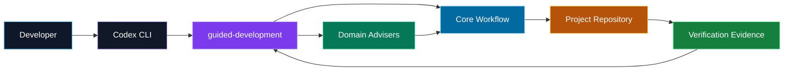

# Dev Agent Skills

<p align="center">
  <strong>An evidence-driven software development methodology for coding agents.</strong>
</p>

<p align="center">
  <a href="README.md"></a>
  <a href="README.en.md"></a>
</p>

<p align="center">
  
  
  
  
</p>

<p align="center">
  Author: <a href="https://github.com/doanvinhlong18"><strong>doanvinhlong18</strong></a>
</p>

`dev-agent-skills` is a collection of skills that helps coding agents
investigate, plan, implement, and verify software changes through a consistent
workflow. It is designed to keep developers in control of technical reasoning,
scope, evidence, and consequential decisions.

## Status

> **Maturity: project-scoped pilot.**

The repository includes a behavioral test suite, a Codex adapter, and focused
evidence for the main workflows. It is currently intended for reviewed,
project-scoped adoption. No stable release or v1.0 is declared yet. See
[Validation status](#validation-status) and the
[V1 Audit](docs/V1_AUDIT.md) for current limitations.

<table>
  <tr>
    <td align="center"><strong>Evidence-driven</strong><br>Investigate before editing</td>
    <td align="center"><strong>One active step</strong><br>No coding ahead</td>
    <td align="center"><strong>Independent verification</strong><br>Expected before observed</td>
    <td align="center"><strong>Developer ownership</strong><br>Conditional gates</td>
  </tr>
</table>

## Why this project exists

Coding agents can produce code quickly, but they can also:

- patch before understanding the cause;
- edit until tests turn green without explaining why;
- implement several dependent steps at once;
- expand scope silently;
- mix a bug fix with cleanup or redesign;
- define expected behavior after seeing the output;
- weaken a test or update a snapshot to hide a defect;
- declare completion when implementation is only written, not verified;
- create low-value approvals or quizzes;
- leave developers with code they cannot confidently maintain.

`dev-agent-skills` turns these risks into observable workflow invariants.

## What the skills provide

### Evidence-driven investigation

Agents must keep these concepts separate:

- **Fact:** something observed from the repository, runtime, logs, tests,
  queries, or documentation;
- **Hypothesis:** a plausible explanation that is not yet proven;
- **Confirmed root cause:** an explanation supported by evidence that
  distinguishes it from credible alternatives.

### Incremental implementation

Only one logical step may be active in an iteration. Future steps stay locked
until their dependencies, verification, and applicable gates are satisfied.

### Scope control

Prerequisites, migrations, shared contracts, and out-of-scope behavior must be
recorded explicitly. An agent may not broaden a change simply because a nearby
file is already open.

### Independent verification

Expected behavior must be established before post-change output is judged.
Verification records one of three outcomes:

| Result | Meaning |
| --- | --- |
| `PASS` | Observed behavior matches the expectation with sufficient evidence |
| `FAIL` | Observed behavior contradicts the expectation or a scope invariant |
| `INCONCLUSIVE` | The observation method cannot distinguish success from failure |

### Conditional Understanding Gates

A gate is used only when misunderstanding a specific change would materially
reduce the developer's ability to maintain, debug, extend, or operate it.

Changes that may require a gate include:

- transaction or rollback boundaries;
- security and tenant ownership;
- concurrency or data-integrity invariants;
- retry ownership and idempotency;
- shared decision boundaries;
- architecture decisions with consequential trade-offs.

Mechanical changes such as local renames, import corrections, and routine
documentation updates normally do not require a gate.

### Targeted Knowledge Building

The skill set does not only check understanding. It also helps the developer
learn exactly what is missing, in the context of the change being made:

- **Questions grounded in real code:** questions come from the task, evidence,
  root cause, diff, and current verification result, not generic theory. They
  can target WHY, HOW, FLOW, EDGE CASE, COUNTERFACTUAL, or PREDICTION.
- **Developer answers first:** no model answer is shown before the developer
  responds, so they reason for themselves instead of rereading the agent's
  conclusion.
- **Causal evaluation:** the outcome is `passed`, `partial`, or `failed`,
  based on whether the developer connects mechanism to behavior, not on
  keyword matching.
- **Targeted teaching on gaps:** for `partial` or `failed`, the skill explains
  only the missing concept using evidence from the current change, then asks one
  follow-up question. It does not turn into a long lecture.
- **Prediction when it teaches:** the developer may be asked to predict the
  output for a specific input or state to test their mental model.
- **No step advance while the gate is open:** the next step unlocks only after
  the developer shows the required understanding.

```text
Verification PASS -> assess ownership value
   -> not required: next step
   -> required: ask -> developer answers -> evaluate
        -> passed: next step
        -> partial/failed: teach the missing part -> re-ask
```

The skill avoids over-teaching: syntax trivia, vocabulary recall, generic
theory, and questions answerable without understanding the current change are
excluded. Developers can always ask for more explanation in a prompt, for
example: `Explain why this approach is safer than the old one before the next
step`.

Note: the skill cannot force real understanding. It creates structured
checkpoints and feedback; learning still depends on the developer.
### Proportional process

Small, local, mechanical, low-risk work can use a minimal fast path. A one-line
change still uses the standard workflow when it affects authorization,
transactions, concurrency, migrations, public contracts, or data integrity.

## Workflow

### Standard workflow

```text
task understanding
  -> investigation
  -> decomposition
  -> implementation (one logical step)
  -> verification
  -> understanding applicability
     -> no gate: next step or complete
     -> required gate: understanding gate -> next step or complete
```

### Minimal workflow

```text
brief understanding
  -> compact one-step decomposition
  -> implementation
  -> focused verification
  -> no-gate applicability record
  -> complete
```

### Architecture decision workflow

```text
understanding
  -> investigation
  -> decomposition
  -> understanding_gate(decision)
  -> next eligible implementation
```

Dependent implementation remains locked until the decision is evidence-backed,
trade-offs are recorded, and any required decision-level gate passes.

### Prerequisite refactor workflow

```text
decomposition
  -> implementation(refactor)
  -> verification(refactor)
  -> required ownership checkpoint
  -> implementation(dependent behavior)
```

## Skill catalog

### Core workflow skills

| Skill | Responsibility |
| --- | --- |
| `$guided-development` | Main orchestrator; selects workflow stages, child skills, and legal transitions |
| `$task-understanding` | Establishes the request, expected behavior, knowns, unknowns, and scope |
| `$code-investigation` | Collects read-only evidence and evaluates causal explanations |
| `$task-decomposition` | Produces dependency-aware logical steps and verification strategies |
| `$incremental-implementation` | Implements exactly one active step within approved scope |
| `$verification` | Compares expected and observed behavior and checks diff scope |
| `$understanding-gate` | Assesses ownership value and runs the smallest useful gate when required |

Developers normally configure only `$guided-development`; the orchestrator
selects the remaining core skills from task state.

### Domain advisory skills

| Skill | Coverage |
| --- | --- |
| `$java` | Java/JVM, compiler, runtime, concurrency, serialization, compatibility |
| `$spring` | Beans, proxies, transactions, MVC, validation, security, events, async |
| `$sql` | Query correctness, joins, null semantics, constraints, transactions, plans |
| `$angular` | Components, templates, signals, RxJS, DI, routing, forms, HTTP |
| `$testing` | Focused checks, unit/integration boundaries, fixtures, test doubles |
| `$git` | Worktree, diffs, history, blame, ancestry, and regression archaeology |

Domain skills are advisers. They cannot change workflow state, modify project
files on their own, or declare a task complete.

## Architecture

```text
dev-agent-skills/
  core/                 # Workflow authority
  domains/              # Technical advisers
  adapters/codex/       # Codex installation and discovery bridge
  docs/                 # Normative policies and architecture
  tests/scenarios/      # Behavioral contracts
  tests/runs/           # Immutable execution evidence
```

```text
project context -> Codex adapter -> core workflow -> domain advisers
```

Project instructions may add commands, protected paths, and stricter rules,
but they may not weaken core workflow invariants.



## Technology and ecosystem

### Methodology platform

| Technology | Role |
| --- | --- |
| Markdown + YAML front matter | Human-readable, reviewable, version-controlled skill contracts |
| `AGENTS.md` | Connects the shared methodology to repository-specific context |
| `.agents/skills` | Codex skill discovery at project or user scope |
| TOML | Optional Codex host configuration through `.codex/config.toml` |
| PowerShell | Windows installer, validator, and behavioral harness |
| JSON / JSONL / YAML | Execution manifests, events, and immutable evaluation evidence |
| Mermaid | GitHub-rendered workflow and architecture diagrams |

### Domain ecosystem

<p>
  
  
  
  
  
  
</p>

The core methodology is framework-independent. Domain skills add specialized
reasoning without taking workflow authority. The current adapter integrates
with Codex CLI, while the core contracts remain separate so other adapters can
be added later.

## Codex quick start

### Requirements

- Codex CLI installed and working;
- PowerShell 5.1 or PowerShell 7 (`pwsh`);
- permission to create symbolic links or junctions (Windows may need Developer
  Mode; otherwise the installer falls back to a junction);
- a project with a clear root directory.

The scripts are written in PowerShell. Running them with `pwsh` on macOS or
Linux has not been validated.

### 1. Get the central repository

Clone or extract this repository **once** in a stable location, for example
`C:\tools\dev-agent-skills` or `~/tools/dev-agent-skills`. It is the single
source of truth; do not copy individual skills into each project.

```powershell
git clone <repository-url> C:\tools\dev-agent-skills
```

The commands below use `$skillsRoot` for that path:

```powershell
$skillsRoot = 'C:\tools\dev-agent-skills'
```

### 2. Install into a project with one command

Open PowerShell at the project root and run:

```powershell
cd C:\path\to\your-project
& "$skillsRoot\adapters\codex\scripts\setup-project.ps1"
```

Or pass one or more project paths without changing directory:

```powershell
& "$skillsRoot\adapters\codex\scripts\setup-project.ps1" `
  C:\work\project-a C:\work\project-b
```

The script never scans your disk. You choose which projects to install. For each
project it:

- links all 13 skills (core and domain) into `.agents/skills/`;
- checks that every skill's `SKILL.md` is readable through the link;
- creates `AGENTS.md` if missing. If it exists, it only adds or updates the block
  marked `dev-agent-skills:begin/end` and leaves the rest untouched;
- prints a result table (`13/13`, `created`, `block-appended`, `up-to-date`). A
  failing project is reported on its own row and does not stop the others.

Re-running is safe. If PowerShell blocks the script because of execution policy,
use `powershell -ExecutionPolicy Bypass -File <script path> <project>`.

The block added to `AGENTS.md` tells Codex to use `$guided-development` for every
non-trivial task (bugs, features, refactors, performance tuning, SQL, code
analysis). Its content lives in `adapters/codex/templates/AGENTS.block.md`; edit
that file and re-run the script to update every project.

### 3. Add project-specific context

The shared block has no build command, test command, or protected paths for your
project. Add a short context section to the same `AGENTS.md`, outside the marked
block:

```md
## Project context

- Project identifier: my-project
- Relevant domains: Java, Spring, SQL, Testing, Git
- Build command: mvn.cmd package -DskipTests
- Focused test command: mvn.cmd -Dtest=<TestClass> test
- Protected or generated paths: target/, generated/, applied migrations
- Additional evidence sources: README.md, pom.xml, architecture docs, logs
```

Each project should document:

- build, compile, test, lint, and format commands;
- module or folder boundaries;
- generated or protected paths;
- migration and compatibility policies;
- authoritative behavior documents;
- runtime, log, query, or browser evidence sources;
- destructive commands that must not run.

Keep the file short. Put detailed documentation in project files and reference
it from `AGENTS.md`.

### 4. Start a new Codex session

Codex builds the instruction chain when a run or TUI session starts. After adding
links or editing `AGENTS.md`, start a new session in the project to reload.

<details>
<summary>Manual step-by-step install (without <code>setup-project.ps1</code>)</summary>

Create the skill links:

```powershell
$projectRoot = 'C:\path\to\your-project'

powershell -ExecutionPolicy Bypass `
  -File "$skillsRoot\adapters\codex\scripts\install.ps1" `
  -Scope Project `
  -SourceRoot $skillsRoot `
  -ProjectRoot $projectRoot `
  -LinkType Auto
```

On Windows, `Auto` tries a symbolic link first and falls back to an NTFS
junction. The installer never overwrites a regular directory or a link that
points elsewhere.

Add `AGENTS.md` if the project has none:

```powershell
Copy-Item `
  "$skillsRoot\adapters\codex\templates\project-AGENTS.template.md" `
  "$projectRoot\AGENTS.md"
```

If the project already has `AGENTS.md`, merge the `Shared methodology` section
from the template instead of overwriting the file.

</details>
## Verify the installation

The commands below use `$projectRoot` and `$skillsRoot`:

```powershell
$skillsRoot = 'C:\tools\dev-agent-skills'
$projectRoot = 'C:\path\to\your-project'
```

### Check the link target

```powershell
Get-Item "$projectRoot\.agents\skills\guided-development" -Force |
  Format-List Name, LinkType, Target, FullName
```

### Check shared content

```powershell
Get-FileHash `
  "$skillsRoot\core\guided-development\SKILL.md", `
  "$projectRoot\.agents\skills\guided-development\SKILL.md"
```

The hashes should match.

### Check Codex discovery

```powershell
Push-Location $projectRoot
codex debug prompt-input "skill discovery check"
Pop-Location
```

Confirm that:

- `guided-development` and the domain skills are discovered;
- source paths resolve to the central repository;
- the correct project's `AGENTS.md` is loaded;
- no project-local shadow copy has the same skill name.

## Usage

### Do skills activate automatically?

Yes. When the links and `AGENTS.md` are configured correctly, Codex can select
`$guided-development` automatically for non-trivial tasks. You do not need to
name the skill in every prompt.

Normal prompt:

```text
Fix the NullPointerException when a customer has no phone number.
```

During a pilot, for high-risk work, or when deterministic selection matters,
you can invoke it explicitly:

```text
Use $guided-development for this task.
```

Automatic selection is model-mediated rather than a hard hook. Explicit
invocation increases confidence but is not mandatory.

### Compose domain advisers

```text
Use $guided-development with $java, $spring, and $sql to investigate this bug.
```

The core workflow remains authoritative; domain skills remain advisers.

### Continue an active task

```text
Continue the task using the current workflow state.
```

The agent should select the next legal stage unless it needs real input,
permission, a scope decision, or an Understanding Gate response.

## Prompt examples

### Backend bug

```text
Use $guided-development with $java, $spring, and $testing.
Investigate the NullPointerException when a customer has no phone number.
Do not patch before confirming the nullable contract and failing path.
Implement one bounded step, then verify absent and present values.
```

### Incorrect SQL result

```text
Use $guided-development and $sql to investigate duplicate orders in this report.
Separate observed rows, join structure, and the join fan-out hypothesis.
Establish the expected row set before editing the query.
```

### Angular view update

```text
Use $guided-development, $angular, and $testing.
Investigate route parameter -> RxJS -> HTTP -> rendered DOM.
Do not blame backend latency without timing evidence.
```

### Multi-layer feature

```text
Use $guided-development to add approval comments across the API, service,
persistence, and UI layers. Investigate the contract first, create
dependency-aware steps, implement only the first step, and verify it before
unlocking the next one.
```

### Architecture decision

```text
Use $guided-development to evaluate moving retry ownership into a shared
processing boundary. Compare alternatives, idempotency, terminal failures, and
observability. Do not unlock dependent implementation before a required
decision-level gate passes.
```

### Small mechanical task

```text
Rename this misspelled local variable. Use the minimal fast path if search
confirms there are no external references; still inspect the diff and run the
appropriate compile check.
```

## Install for multiple projects

Pass a list of paths to a single command:

```powershell
& "$skillsRoot\adapters\codex\scripts\setup-project.ps1" `
  C:\work\project-a `
  C:\work\project-b `
  C:\work\project-c
```

The result is one table row per project. If a project fails (folder not found, a
real directory already uses a skill name, a link points elsewhere), the script
reports it on that row, still processes the remaining projects, and exits with a
non-zero code.

Each project still needs its own `Project context`. Do not share build commands,
protected paths, or architecture context across unrelated repositories.
## Project scope and user scope

### Project scope — recommended

```powershell
powershell -ExecutionPolicy Bypass `
  -File "$skillsRoot\adapters\codex\scripts\install.ps1" `
  -Scope Project `
  -SourceRoot $skillsRoot `
  -ProjectRoot $projectRoot
```

Project scope exposes the skills only to the selected repository. It is easier
to pilot, isolate, review, and roll back.

### User scope

```powershell
powershell -ExecutionPolicy Bypass `
  -File "$skillsRoot\adapters\codex\scripts\install.ps1" `
  -Scope User `
  -SourceRoot $skillsRoot
```

On Windows, the destination is `%USERPROFILE%\.agents\skills`. Projects should
still keep local `AGENTS.md` files for commands and boundaries.

Project scope is currently recommended. Avoid installing the same skill at
multiple scopes without a reason; Codex may discover duplicate names rather
than merge them.

## Updating

Consuming projects link to the central repository, so central changes appear
on disk without reinstalling.

After an update:

1. review core and domain skill changes;
2. run the relevant validation or behavioral tests;
3. close existing Codex sessions;
4. start a new session in the project.

Run the installer again only when a skill is added, a project is missing a
link, the central repository moves, or a link is broken. The installer is
idempotent and reports valid existing links as `already-linked`.

## Safety boundaries

The methodology explicitly resists:

- patch-until-green loops without reasoning recovery;
- test weakening and post-hoc expectations;
- coding ahead into future steps;
- silent scope expansion;
- opportunistic cleanup;
- speculative abstractions and dependencies;
- destructive Git actions during investigation;
- domain skills taking workflow authority;
- completion before verification;
- automatic Understanding Gates for mechanical work.

Instruction adherence is still model-mediated. These skills improve
consistency and observability, but they are not a substitute for sandboxing,
access control, code review, or project tests.

## Troubleshooting

### `Destination exists and is not a link`

The destination is a regular directory or a manual copy. Inspect and back it up
before replacing it with a central link. The installer intentionally refuses
to overwrite it.

### `Destination link points elsewhere`

Inspect the current target:

```powershell
Get-Item '.agents\skills\guided-development' -Force |
  Format-List LinkType, Target, FullName
```

Replace the link only after confirming which central repository is
authoritative.

### Symbolic link creation fails on Windows

Use `-LinkType Auto` to fall back to a junction, or request one explicitly:

```powershell
powershell -ExecutionPolicy Bypass `
  -File "$skillsRoot\adapters\codex\scripts\install.ps1" `
  -Scope Project `
  -SourceRoot $skillsRoot `
  -ProjectRoot $projectRoot `
  -LinkType Junction
```

Junctions are appropriate for local NTFS paths. Network shares usually require
symbolic links.

### Codex does not discover a skill

1. Check that the link exists and resolves to the expected target.
2. Check that the target contains `SKILL.md`.
3. Check for duplicate skill names at another scope.
4. Run `codex debug prompt-input` from the project root.
5. Start a new Codex session.

### Codex does not load `AGENTS.md`

- confirm Codex is running inside the project tree;
- check whether `AGENTS.override.md` takes precedence;
- confirm the file is non-empty;
- check `project_doc_max_bytes`;
- start a new session after editing instructions.

### The agent asks too many questions or edits several steps

Reinforce the minimality and one-active-step invariants:

```text
Ask only when the answer changes expected behavior, scope, permission, a
technical decision, or a required ownership outcome. Keep exactly one active
logical step; future steps remain locked.
```

## Validation status

The behavioral scenario suite covers:

- task understanding and ambiguity;
- investigation and root-cause discipline;
- decomposition, dependencies, and coding ahead;
- scope control and minimality;
- verification recovery;
- post-hoc expectations and test weakening;
- Understanding Gate pass, partial, fail, and non-applicability;
- Java, Spring, SQL, Angular, Testing, and Git boundaries;
- Codex discovery, isolation, and precedence.

Known core issues around decision-level gates and prerequisite ownership locks
have been fixed with repeated focused evidence. The current maturity remains a
**project-scoped pilot** until a final full regression and real-task dogfooding
are completed against the current state.

Evidence and limitations:

- [Behavioral Testing](docs/BEHAVIORAL_TESTING.md)
- [Test Runs](tests/README.md)
- [V1 Audit](docs/V1_AUDIT.md)

## Recommended rollout

1. Select one project with clear build and test commands.
2. Install at project scope.
3. Create a concise, accurate `AGENTS.md` with protected paths.
4. Run a read-only smoke test.
5. Pilot on reviewed real tasks.
6. Monitor diff size, question count, gate applicability, and recovery.
7. Turn undesirable behavior into a scenario before wider rollout.

## Documentation

| Document | Contents |
| --- | --- |
| [Development Philosophy](docs/PHILOSOPHY.md) | AI-assisted rather than AI-owned development |
| [Core Principles](docs/CORE_PRINCIPLES.md) | Normative workflow invariants |
| [System Architecture](docs/ARCHITECTURE.md) | Layers, responsibilities, and dependencies |
| [State Machine](docs/STATE_MACHINE.md) | Task state, transitions, and recovery |
| [Minimality Policy](docs/MINIMALITY_POLICY.md) | Minimal sufficient change and process |
| [Understanding Protocol](docs/UNDERSTANDING_PROTOCOL.md) | Gate applicability and evaluation |
| [Domain Skills](docs/DOMAIN_SKILLS.md) | Domain adviser boundaries |
| [Codex Adapter](docs/CODEX_ADAPTER.md) | Installation, discovery, and precedence |
| [Behavioral Testing](docs/BEHAVIORAL_TESTING.md) | Scenario contracts and evaluation |
| [V1 Audit](docs/V1_AUDIT.md) | Findings, evidence, and limitations |

## In short

```text
1. Install skill links with -Scope Project
2. Add or merge AGENTS.md
3. Document build/test/protected paths
4. Start a new Codex session
5. Verify links and prompt-input
6. Assign tasks normally or invoke $guided-development explicitly
7. Review evidence, scope, verification, and gate outcomes
```

The goal is not to make coding agents slower. It is to remove fast but
unreliable behavior while keeping genuinely simple work simple.

## Author

Created and maintained by [doanvinhlong18](https://github.com/doanvinhlong18).
