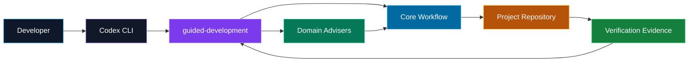

# Dev Agent Skills

<p align="center">
  <strong>Phương pháp phát triển phần mềm có kiểm chứng dành cho coding agent.</strong>
</p>

<p align="center">
  <a href="README.md"></a>
  <a href="README.en.md"></a>
</p>

<p align="center">
  
  
  
  
</p>

<p align="center">
  Tác giả: <a href="https://github.com/doanvinhlong18"><strong>doanvinhlong18</strong></a>
</p>

`dev-agent-skills` là bộ skill giúp coding agent điều tra, lập kế hoạch, triển
khai và kiểm chứng thay đổi phần mềm theo một workflow nhất quán. Bộ skill được
thiết kế để AI hỗ trợ developer mà không thay developer sở hữu reasoning, scope
và các quyết định kỹ thuật quan trọng.

## Trạng thái

> **Mức độ trưởng thành: project-scoped pilot.**

Bộ skill đã có behavioral test suite, Codex adapter và bằng chứng kiểm chứng cho
các workflow chính. Hiện nên cài theo từng project và sử dụng có review. Dự án
chưa tuyên bố stable release hoặc v1.0. Xem
[trạng thái kiểm chứng](#trạng-thái-kiểm-chứng) và
[V1 Audit](docs/V1_AUDIT.md) để biết giới hạn hiện tại.

<table>
  <tr>
    <td align="center"><strong>Evidence-driven</strong><br>Điều tra trước khi sửa</td>
    <td align="center"><strong>One active step</strong><br>Không coding-ahead</td>
    <td align="center"><strong>Independent verification</strong><br>Expected trước observed</td>
    <td align="center"><strong>Developer ownership</strong><br>Gate có điều kiện</td>
  </tr>
</table>

## Tại sao cần bộ skill này?

Coding agent có thể viết code nhanh nhưng cũng dễ:

- patch trước khi hiểu nguyên nhân;
- sửa đến khi test xanh mà không biết vì sao;
- triển khai nhiều bước phụ thuộc cùng lúc;
- mở rộng scope âm thầm;
- trộn bug fix với cleanup hoặc redesign;
- định nghĩa expected result sau khi đã thấy output;
- weaken test hoặc update snapshot để che lỗi;
- tuyên bố hoàn thành khi mới chỉ viết xong code;
- tạo quá nhiều approval hoặc quiz không mang lại giá trị;
- để developer nhận code nhưng mất mental model để bảo trì.

`dev-agent-skills` biến các rủi ro đó thành các workflow invariant có thể quan
sát và kiểm chứng.

## Bộ skill hỗ trợ gì?

### Điều tra dựa trên bằng chứng

Agent phải phân biệt rõ:

- **Fact:** điều đã quan sát từ repository, runtime, log, test, query hoặc tài
  liệu;
- **Hypothesis:** lời giải thích có thể đúng nhưng chưa được chứng minh;
- **Confirmed root cause:** nguyên nhân đã có evidence phân biệt với các khả
  năng cạnh tranh.

### Triển khai từng bước nhỏ

Mỗi iteration chỉ có một logical step được active. Future steps vẫn locked cho
đến khi dependency, verification và gate liên quan đã hoàn tất.

### Kiểm soát scope

Prerequisite, migration, shared contract hoặc behavior ngoài scope phải được
ghi nhận rõ. Agent không được sửa thêm chỉ vì “đang tiện mở file này”.

### Verification độc lập

Expected result phải được xác lập trước khi đánh giá output. Verification ghi
một trong ba kết quả:

| Kết quả | Ý nghĩa |
| --- | --- |
| `PASS` | Observed behavior phù hợp expectation với evidence đủ dùng |
| `FAIL` | Observed behavior mâu thuẫn expectation hoặc scope invariant |
| `INCONCLUSIVE` | Observation method chưa phân biệt được success và failure |

### Understanding Gate có điều kiện

Gate chỉ xuất hiện khi việc hiểu sai thay đổi có thể gây khó khăn đáng kể cho
maintenance, debugging, extension hoặc vận hành.

Các thay đổi có thể cần gate:

- transaction hoặc rollback boundary;
- security và tenant ownership;
- concurrency hoặc data-integrity invariant;
- retry ownership và idempotency;
- shared decision boundary;
- architecture decision có trade-off quan trọng.

Các thay đổi cơ học như rename local variable, sửa import hoặc cập nhật tài
liệu thường không cần gate.

### Bổ sung kiến thức đúng chỗ

Bộ skill không chỉ kiểm tra mà còn giúp developer học đúng phần còn thiếu, ngay
trong ngữ cảnh của thay đổi đang làm:

- **Câu hỏi bám vào code thật:** câu hỏi sinh ra từ task, evidence, root cause,
  diff và kết quả verification hiện tại, không phải câu hỏi lý thuyết chung. Có
  thể hỏi theo các góc: WHY, HOW, FLOW, EDGE CASE, COUNTERFACTUAL, PREDICTION.
- **Developer trả lời trước:** skill không đưa đáp án mẫu trước khi developer
  trả lời, nên developer phải tự suy luận thay vì đọc lại kết luận của agent.
- **Đánh giá theo suy luận nhân quả:** kết quả là `passed`, `partial` hoặc
  `failed`, dựa trên việc developer có nối được cơ chế với hành vi hay không,
  không dựa vào việc dùng đúng từ khóa.
- **Teach có mục tiêu khi chưa đạt:** nếu `partial` hoặc `failed`, skill chỉ
  giải thích khái niệm còn thiếu, dùng đúng evidence của thay đổi hiện tại, rồi
  hỏi lại một câu follow-up. Không biến thành bài giảng dài.
- **Prediction khi thật sự có ích:** có thể yêu cầu dự đoán output cho một
  input hoặc trạng thái cụ thể để developer kiểm chứng mental model của mình.
- **Không chuyển step khi gate chưa xong:** step kế tiếp chỉ mở sau khi
  developer thể hiện được hiểu biết cần thiết.

```text
Verification PASS -> đánh giá ownership value
   -> không cần: sang step tiếp theo
   -> cần: hỏi -> developer trả lời -> đánh giá
        -> passed: sang step tiếp theo
        -> partial/failed: teach đúng chỗ thiếu -> hỏi lại
```

Skill không dạy tràn lan: syntax trivia, từ vựng, lý thuyết chung hoặc câu hỏi
có thể trả lời mà không cần hiểu thay đổi hiện tại đều bị loại. Developer luôn
có thể yêu cầu giải thích thêm bằng prompt, ví dụ: `Giải thích vì sao cách này
an toàn hơn cách cũ trước khi sang step tiếp theo`.

Lưu ý: skill không thể ép developer thật sự hiểu. Nó tạo điểm dừng và phản hồi
có cấu trúc, còn việc học vẫn do developer chủ động.
### Quy trình tương xứng với độ khó

Task nhỏ dùng minimal fast path. Task có security, concurrency, migration,
transaction, public contract hoặc data-integrity risk vẫn phải đi qua standard
workflow dù diff chỉ có một dòng.

## Workflow

### Standard workflow

```text
task understanding
  -> investigation
  -> decomposition
  -> implementation (một logical step)
  -> verification
  -> understanding applicability
     -> no gate: next step hoặc complete
     -> required gate: understanding gate -> next step hoặc complete
```

### Minimal workflow

```text
brief understanding
  -> compact one-step decomposition
  -> implementation
  -> focused verification
  -> no-gate applicability record
  -> complete
```

### Architecture decision workflow

```text
understanding
  -> investigation
  -> decomposition
  -> understanding_gate(decision)
  -> next eligible implementation
```

Dependent implementation vẫn locked cho đến khi decision được evidence-backed,
trade-offs được ghi nhận và gate bắt buộc đã pass.

### Prerequisite refactor workflow

```text
decomposition
  -> implementation(refactor)
  -> verification(refactor)
  -> required ownership checkpoint
  -> implementation(dependent behavior)
```

## Skill catalog

### Core workflow skills

| Skill | Trách nhiệm |
| --- | --- |
| `$guided-development` | Orchestrator chính; chọn workflow stage, child skill và legal transition |
| `$task-understanding` | Xác lập request, expected behavior, knowns, unknowns và scope |
| `$code-investigation` | Thu thập evidence read-only và đánh giá causal explanations |
| `$task-decomposition` | Chia task thành logical steps có dependency và verification strategy |
| `$incremental-implementation` | Triển khai đúng một active step trong approved scope |
| `$verification` | So sánh expected với observed và kiểm tra diff/scope |
| `$understanding-gate` | Đánh giá ownership value và thực hiện gate tối thiểu khi cần |

Thông thường developer chỉ cần cấu hình `$guided-development`. Orchestrator sẽ
tự chọn các core skill còn lại theo state của task.

### Domain advisory skills

| Skill | Phạm vi hỗ trợ |
| --- | --- |
| `$java` | Java/JVM, compiler, runtime, concurrency, serialization, compatibility |
| `$spring` | Beans, proxies, transactions, MVC, validation, security, events, async |
| `$sql` | Query correctness, joins, null semantics, constraints, transactions, plans |
| `$angular` | Components, templates, signals, RxJS, DI, routing, forms, HTTP |
| `$testing` | Focused checks, unit/integration boundaries, fixtures, test doubles |
| `$git` | Worktree, diff, history, blame, ancestry và regression archaeology |

Domain skills là adviser. Chúng không được tự thay đổi workflow state, sửa code
hoặc tuyên bố task hoàn thành.

## Kiến trúc

```text
dev-agent-skills/
  core/                 # Workflow authority
  domains/              # Technical advisers
  adapters/codex/       # Codex installation và discovery bridge
  docs/                 # Normative policies và architecture
  tests/scenarios/      # Behavioral contracts
  tests/runs/           # Immutable execution evidence
```

```text
project context -> Codex adapter -> core workflow -> domain advisers
```

Project instructions có thể bổ sung command, protected path và rule chặt hơn,
nhưng không được làm yếu core workflow invariant.



## Công nghệ và hệ sinh thái

### Nền tảng phương pháp

| Công nghệ | Vai trò |
| --- | --- |
| Markdown + YAML front matter | Định nghĩa skill contract dễ đọc, dễ review và version-control |
| `AGENTS.md` | Kết nối methodology với context riêng của từng repository |
| `.agents/skills` | Codex skill discovery ở project hoặc user scope |
| TOML | Codex host configuration tùy chọn qua `.codex/config.toml` |
| PowerShell | Installer, validator và behavioral harness trên Windows |
| JSON / JSONL / YAML | Execution manifest, events và immutable evaluation evidence |
| Mermaid | Minh họa workflow và architecture trực tiếp trên GitHub |

### Domain ecosystem

<p>
  
  
  
  
  
  
</p>

Core methodology không phụ thuộc framework. Domain skills bổ sung reasoning
chuyên biệt nhưng không chiếm quyền workflow. Adapter hiện tại tích hợp với
Codex CLI; core contract được giữ tách biệt để có thể bổ sung adapter khác.

## Quick start cho Codex

### Yêu cầu

- Codex CLI đã được cài và chạy được;
- PowerShell 5.1 hoặc PowerShell 7;
- quyền tạo symbolic link hoặc junction;
- một project có root directory rõ ràng.

### 1. Đặt repository trung tâm

Clone hoặc đặt repository này ở một location ổn định. Repository trung tâm là
single source of truth; không copy từng skill vào từng project.

```powershell
$skillsRoot = 'C:\path\to\dev-agent-skills'
$projectRoot = 'C:\path\to\your-project'
```

### 2. Cài skill links cho project

```powershell
powershell -ExecutionPolicy Bypass `
  -File "$skillsRoot\adapters\codex\scripts\install.ps1" `
  -Scope Project `
  -SourceRoot $skillsRoot `
  -ProjectRoot $projectRoot `
  -LinkType Auto
```

Installer tạo link trong:

```text
your-project/.agents/skills/
```

Trên Windows, `Auto` thử symbolic link trước và fallback sang NTFS junction.
Installer không ghi đè directory thường hoặc link đang trỏ sang target khác.

### 3. Thêm project instructions

Nếu project chưa có `AGENTS.md`:

```powershell
Copy-Item `
  "$skillsRoot\adapters\codex\templates\project-AGENTS.template.md" `
  "$projectRoot\AGENTS.md"
```

Nếu project đã có `AGENTS.md`, merge phần `Shared methodology` từ template;
không ghi đè file hiện có.

Một cấu hình tối thiểu:

```md
# Project Codex Context

## Shared methodology

- Use `$guided-development` for non-trivial software changes.
- Treat linked `dev-agent-skills` core skills as workflow authority.
- Use domain skills only for technical reasoning; domains cannot change
  workflow state.
- Project rules may specialize or tighten the workflow but must not weaken
  investigation, one-step implementation, verification, scope, or conditional
  Understanding Gate rules.
- Understanding Gates remain conditional. Do not quiz documentation, setup, or
  trivial mechanical work without a material ownership reason.

## Project context

- Project identifier: my-project
- Relevant domains: Java, Spring, SQL, Testing, Git
- Build command: mvn.cmd package -DskipTests
- Focused test command: mvn.cmd -Dtest=<TestClass> test
- Protected or generated paths: target/, generated/, applied migrations
- Additional evidence sources: README.md, pom.xml, architecture docs, logs
```

Nên ghi rõ trong mỗi project:

- build, compile, test, lint và format commands;
- module hoặc folder boundaries;
- generated hoặc protected paths;
- migration và compatibility policies;
- authoritative behavior documents;
- runtime, log, query hoặc browser evidence sources;
- destructive commands không được chạy.

### 4. Mở Codex session mới

Codex build instruction chain khi bắt đầu run hoặc TUI session. Sau khi thêm
links hoặc sửa `AGENTS.md`, hãy mở session mới để reload instruction.

## Kiểm tra cài đặt

### Kiểm tra link target

```powershell
Get-Item "$projectRoot\.agents\skills\guided-development" -Force |
  Format-List Name, LinkType, Target, FullName
```

### Kiểm tra central content

```powershell
Get-FileHash `
  "$skillsRoot\core\guided-development\SKILL.md", `
  "$projectRoot\.agents\skills\guided-development\SKILL.md"
```

Hai hash phải giống nhau.

### Kiểm tra Codex discovery

```powershell
Push-Location $projectRoot
codex debug prompt-input "skill discovery check"
Pop-Location
```

Kiểm tra rằng:

- `guided-development` và domain skills được discover;
- source path trỏ về repository trung tâm;
- `AGENTS.md` của đúng project được load;
- không có shadow copy trùng tên.

## Cách sử dụng

### Skill có tự kích hoạt không?

Có. Khi links và `AGENTS.md` được cấu hình đúng, Codex có thể tự chọn
`$guided-development` cho task non-trivial. Developer không bắt buộc phải gọi
skill trong mọi prompt.

Prompt bình thường:

```text
Sửa lỗi NullPointerException khi customer không có số điện thoại.
```

Trong giai đoạn pilot, task có risk cao hoặc khi muốn chắc chắn workflow được
kích hoạt, có thể gọi rõ:

```text
Dùng $guided-development để xử lý task này.
```

Auto-activation là model-mediated, không phải hook cứng. Gọi skill trực tiếp là
cách tăng độ chắc chắn, không phải yêu cầu bắt buộc.

### Kết hợp domain skills

```text
Dùng $guided-development cùng $java, $spring và $sql để điều tra lỗi này.
```

Core workflow vẫn là authority; domain skills chỉ đóng vai trò adviser.

### Tiếp tục task đang chạy

```text
Tiếp tục task theo workflow hiện tại.
```

Agent tự chọn legal next stage, trừ khi cần input, permission, scope decision
hoặc Understanding Gate response thật sự.

## Prompt mẫu

### Bug backend

```text
Dùng $guided-development cùng $java, $spring và $testing.
Điều tra NullPointerException khi customer không có phone number.
Không patch trước khi xác nhận nullable contract và failing path.
Chỉ triển khai một bounded step rồi verify absent và present value.
```

### SQL trả sai kết quả

```text
Dùng $guided-development và $sql để điều tra report trả duplicate order.
Phân biệt observed rows, join structure và giả thuyết join fan-out.
Xác lập expected row set trước khi sửa query.
```

### Angular view không update

```text
Dùng $guided-development, $angular và $testing.
Điều tra route parameter -> RxJS -> HTTP -> rendered DOM.
Không kết luận backend chậm nếu chưa có timing evidence.
```

### Multi-layer feature

```text
Dùng $guided-development để thêm approval comments qua API, service,
persistence và UI. Điều tra contract trước, chia dependency-aware steps,
chỉ implement step đầu tiên và verify trước khi mở step sau.
```

### Architecture decision

```text
Dùng $guided-development để đánh giá việc chuyển retry ownership vào shared
processing boundary. So sánh alternatives, idempotency, terminal failures và
observability. Không mở dependent implementation trước decision-level gate nếu
ownership risk yêu cầu.
```

### Task nhỏ

```text
Đổi tên local variable bị sai chính tả. Dùng minimal fast path nếu search xác
nhận không có external reference; vẫn kiểm tra diff và compile phù hợp.
```

## Cài cho nhiều project

```powershell
$skillsRoot = 'C:\path\to\dev-agent-skills'
$projects = @(
  'C:\work\project-a',
  'C:\work\project-b',
  'C:\work\project-c'
)

foreach ($projectRoot in $projects) {
  powershell -ExecutionPolicy Bypass `
    -File "$skillsRoot\adapters\codex\scripts\install.ps1" `
    -Scope Project `
    -SourceRoot $skillsRoot `
    -ProjectRoot $projectRoot `
    -LinkType Auto
}
```

Mỗi project vẫn cần `AGENTS.md` riêng. Không dùng chung build command,
protected paths hoặc architecture context giữa các repository không liên quan.

## Project scope và user scope

### Project scope — khuyến nghị

Project scope chỉ expose skills cho repository được chọn:

```powershell
powershell -ExecutionPolicy Bypass `
  -File "$skillsRoot\adapters\codex\scripts\install.ps1" `
  -Scope Project `
  -SourceRoot $skillsRoot `
  -ProjectRoot $projectRoot
```

Đây là lựa chọn phù hợp để pilot, cô lập context và rollback dễ dàng.

### User scope

User scope expose skills cho mọi repository của user:

```powershell
powershell -ExecutionPolicy Bypass `
  -File "$skillsRoot\adapters\codex\scripts\install.ps1" `
  -Scope User `
  -SourceRoot $skillsRoot
```

Đích trên Windows là `%USERPROFILE%\.agents\skills`. Mỗi project vẫn nên có
`AGENTS.md` riêng để cung cấp local commands và boundaries.

Hiện project scope được khuyến nghị. Tránh cài cùng skill ở nhiều scope nếu
không cần vì Codex có thể discover nhiều skill cùng tên thay vì merge.

## Cập nhật

Project dùng links tới repository trung tâm nên central update tự xuất hiện
trên filesystem. Không cần chạy installer lại khi chỉ thay nội dung `SKILL.md`.

Sau khi cập nhật:

1. review thay đổi core/domain skills;
2. chạy validation hoặc behavioral tests phù hợp;
3. đóng Codex session cũ;
4. mở session mới trong project.

Chạy installer lại khi thêm skill mới, project thiếu link, central repository
đổi location hoặc link bị hỏng. Installer idempotent: link đúng target được báo
`already-linked`.

## Safety boundaries

Bộ skill chủ động ngăn các hành vi sau:

- patch-until-green không có reasoning recovery;
- weakening test hoặc post-hoc expectation;
- coding-ahead sang future step;
- silent scope expansion;
- opportunistic cleanup;
- speculative abstraction hoặc dependency;
- destructive Git operation trong investigation;
- domain skill chiếm quyền workflow;
- completion trước verification;
- automatic Understanding Gate cho task cơ học.

Instruction adherence vẫn là model-mediated. Bộ skill cải thiện tính nhất quán
và khả năng quan sát, nhưng không phải sandbox hoặc policy engine thay thế cho
review, tests và access control.

## Troubleshooting

### `Destination exists and is not a link`

Destination đang là directory thật hoặc copy thủ công. Không xóa ngay. Inspect,
backup nếu cần, sau đó mới thay bằng link tới central source.

### `Destination link points elsewhere`

Kiểm tra target:

```powershell
Get-Item '.agents\skills\guided-development' -Force |
  Format-List LinkType, Target, FullName
```

Chỉ thay link sau khi xác nhận repository nào là authoritative.

### Không tạo được symbolic link trên Windows

Dùng `-LinkType Auto` để fallback sang junction hoặc chọn rõ:

```powershell
powershell -ExecutionPolicy Bypass `
  -File "$skillsRoot\adapters\codex\scripts\install.ps1" `
  -Scope Project `
  -SourceRoot $skillsRoot `
  -ProjectRoot $projectRoot `
  -LinkType Junction
```

Junction phù hợp với local NTFS paths; network share thường cần symbolic link.

### Codex không thấy skill

1. Kiểm tra link và target.
2. Kiểm tra `SKILL.md` tồn tại.
3. Kiểm tra duplicate skill names ở scope khác.
4. Chạy `codex debug prompt-input` từ project root.
5. Mở session mới.

### Codex không đọc `AGENTS.md`

- bảo đảm Codex chạy trong project tree;
- kiểm tra `AGENTS.override.md` có override không;
- kiểm tra file không rỗng;
- kiểm tra `project_doc_max_bytes`;
- mở session mới sau khi sửa.

### Agent hỏi quá nhiều hoặc muốn sửa nhiều bước

Nhắc agent áp dụng minimality và one-active-step invariant:

```text
Chỉ hỏi khi câu trả lời thay đổi expected behavior, scope, permission,
technical decision hoặc required ownership outcome. Giữ đúng một active
logical step; future steps vẫn locked.
```

## Trạng thái kiểm chứng

Repository có behavioral scenario suite bao phủ:

- task understanding và ambiguity;
- investigation và root-cause discipline;
- decomposition, dependencies và coding-ahead;
- scope control và minimality;
- verification recovery;
- post-hoc expectations và test weakening;
- Understanding Gate pass, partial, fail và non-applicability;
- Java, Spring, SQL, Angular, Testing và Git boundaries;
- Codex discovery, isolation và precedence.

Các lỗi core đã biết về decision-level gate và prerequisite ownership lock đã
được sửa, với focused repeated evidence. Trạng thái hiện tại vẫn là
**project-scoped pilot** cho đến khi full regression cuối và real-task
dogfooding hoàn tất trên trạng thái hiện tại.

Chi tiết evidence và giới hạn:

- [Behavioral Testing](docs/BEHAVIORAL_TESTING.md)
- [Test Runs](tests/README.md)
- [V1 Audit](docs/V1_AUDIT.md)

## Rollout được khuyến nghị

1. Chọn một project có build và test commands rõ.
2. Cài project scope.
3. Viết `AGENTS.md` ngắn, chính xác và có protected paths.
4. Chạy smoke test read-only.
5. Pilot trên một số task thật với review.
6. Theo dõi diff size, question count, gate applicability và recovery.
7. Chuyển behavior xấu thành behavioral scenario trước khi rollout rộng hơn.

## Tài liệu

| Tài liệu | Nội dung |
| --- | --- |
| [Development Philosophy](docs/PHILOSOPHY.md) | AI-assisted thay vì AI-owned development |
| [Core Principles](docs/CORE_PRINCIPLES.md) | Normative workflow invariants |
| [System Architecture](docs/ARCHITECTURE.md) | Layers, responsibilities và dependencies |
| [State Machine](docs/STATE_MACHINE.md) | Task state, transitions và recovery |
| [Minimality Policy](docs/MINIMALITY_POLICY.md) | Minimal sufficient change và process |
| [Understanding Protocol](docs/UNDERSTANDING_PROTOCOL.md) | Gate applicability và evaluation |
| [Domain Skills](docs/DOMAIN_SKILLS.md) | Domain adviser boundaries |
| [Codex Adapter](docs/CODEX_ADAPTER.md) | Installation, discovery và precedence |
| [Behavioral Testing](docs/BEHAVIORAL_TESTING.md) | Scenario contracts và evaluation |
| [V1 Audit](docs/V1_AUDIT.md) | Findings, evidence và limitations |

## Tóm tắt

```text
1. Cài skill links bằng -Scope Project
2. Thêm hoặc merge AGENTS.md
3. Ghi build/test/protected paths
4. Mở Codex session mới
5. Kiểm tra link và prompt-input
6. Giao task bình thường hoặc gọi $guided-development khi cần chắc chắn
7. Review evidence, scope, verification và gate outcome
```

Mục tiêu không phải làm coding agent chậm hơn. Mục tiêu là loại bỏ những bước
nhanh nhưng không đáng tin, trong khi giữ task đơn giản thật sự đơn giản.

## Tác giả

Được xây dựng và duy trì bởi [doanvinhlong18](https://github.com/doanvinhlong18).
