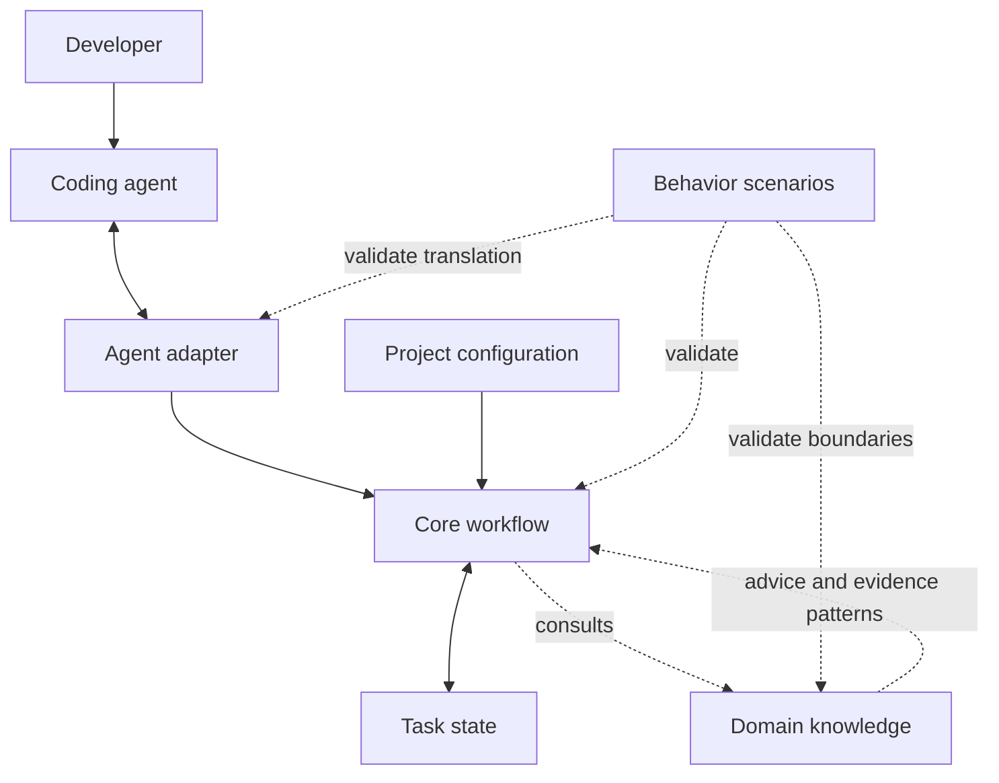
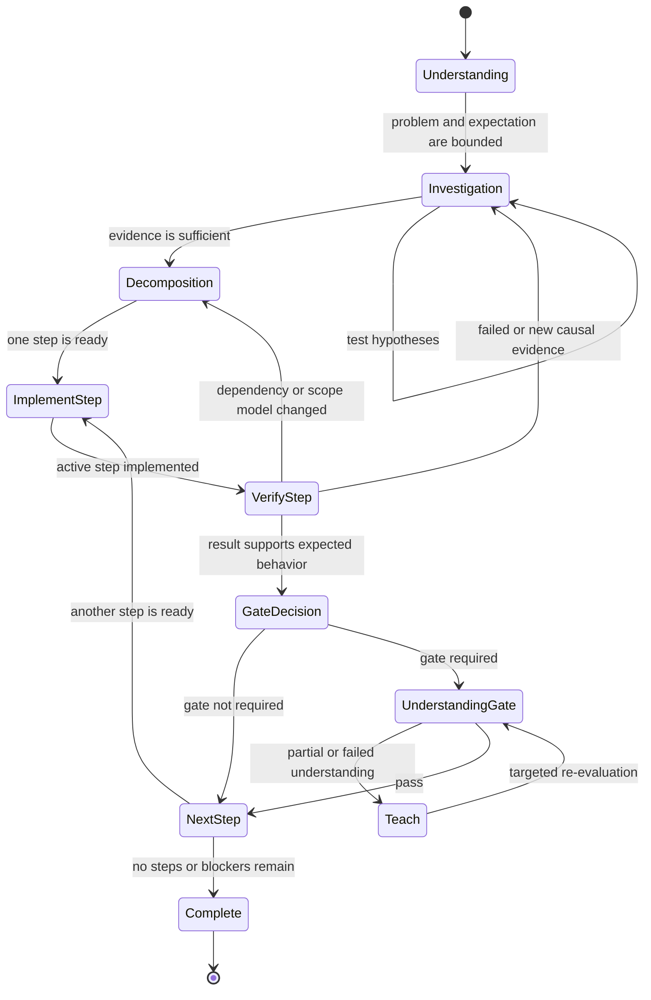

# System Architecture

## Status and scope

This document defines the architecture of `dev-agent-skills`. It separates
workflow policy, technical knowledge, coding-agent integration, project-local
context, task state, and behavioral testing. It does not implement skills,
adapters, state schemas, or a workflow engine.

The architecture is subordinate to [PHILOSOPHY.md](PHILOSOPHY.md) and
[CORE_PRINCIPLES.md](CORE_PRINCIPLES.md). A future component that conflicts with
those documents is invalid even if it conforms to the directory structure in
this document.

## 1. Architectural goals

The system must:

1. preserve developer ownership of meaningful technical reasoning;
2. make workflow order and evidence requirements explicit;
3. keep workflow authority independent of any technology or coding agent;
4. add domain knowledge without allowing that knowledge to control process;
5. allow many projects to share one maintained methodology without copying it;
6. let project rules constrain behavior without weakening core invariants;
7. keep task evidence and progress inspectable and portable;
8. support behavioral scenario testing of agent conduct;
9. remain understandable as files before introducing runtime infrastructure;
10. scale ceremony according to task risk and complexity.

## 2. Repository layout

The initial repository layout is:

```text
dev-agent-skills/
|-- core/                 # Agent-agnostic workflow policy and core skills
|-- domains/              # Technology-specific advisory knowledge
|-- adapters/             # Coding-agent-specific discovery and translation
|-- templates/            # Shared templates for project config and task state
|-- tests/
|   `-- scenarios/        # Technology-neutral behavioral specifications
|-- docs/                 # Constitution, architecture, and protocols
`-- README.md
```

Only the directories needed to make layer boundaries visible are created in
this phase. Empty directories do not imply implemented features. Future phases
may add subdirectories such as `core/guided-development/`, `domains/sql/`, or
`adapters/codex/` when their contracts are defined.

Project-specific configuration does not live in a `projects/` directory here.
The central repository will provide a template, while each consuming repository
will keep only its own small local configuration. This avoids central knowledge
of every project and avoids copied core instructions.

## 3. Layer model



The arrows describe allowed influence, not permission to override policy:

- the adapter exposes the methodology to an agent but does not redefine it;
- the core workflow may consult one or more domains but retains all transition
  authority;
- project configuration supplies local facts, commands, and restrictions but
  cannot weaken core invariants;
- task state is read and updated under core transition rules;
- scenarios observe contracts and expected behavior; they are not runtime
  dependencies.

## 4. Component responsibilities

### 4.1 Core workflow layer

The core layer owns **process**: what stage the task is in, what evidence is
required, which logical step is active, what actions are allowed, and whether a
transition is legal. It contains no Java-, SQL-, Codex-, or project-specific
reasoning.

The initial core responsibilities are:

| Component | Owns | Produces | Must not do |
| --- | --- | --- | --- |
| `guided-development` | Orchestration and transition decisions | The next valid action, transition records, completion decision | Duplicate child-skill logic or delegate workflow authority |
| `task-understanding` | Problem framing before modification | Goal, requested and expected behavior, knowns, unknowns, initial verification idea | Modify production code or invent a solution prematurely |
| `code-investigation` | Evidence collection and causal analysis | Sourced facts, explicit hypotheses, uncertainty, confirmed root cause when justified | Treat hypotheses as facts or implement a fix |
| `task-decomposition` | Conversion of established understanding into bounded work | Ordered logical steps, dependencies, scope, expected behavior, verification strategy | Implement steps or leave future steps implicitly available |
| `incremental-implementation` | The one currently active logical change | A scoped diff and implementation observations | Implement future steps, verify its own correctness, or perform unrelated work |
| `verification` | Expected-versus-observed evaluation | Evidence, `PASS`/`FAIL`/`INCONCLUSIVE`, limitations, recovery recommendation | Change production code to make checks pass or redefine expectations afterward |
| `understanding-gate` | Conditional evaluation of developer ownership | Applicability rationale and, when required, `PASS`/`PARTIAL`/`FAIL` evidence | Act as a generic phase gate or unlock unrelated workflow transitions |

`guided-development` is the sole workflow authority. Child core skills have
narrow state effects and return evidence or a transition request. They do not
independently select a later phase, activate a future step, or mark the task
complete.

### 4.2 Domain knowledge layer

Domain skills answer **how to reason within a technology**. Examples include
Java exception analysis, Spring transaction boundaries, SQL cardinality and
query-plan investigation, Angular change detection, Git history analysis, and
testing strategy.

A domain skill may provide:

- investigation strategies and likely evidence sources;
- common failure modes and dangerous assumptions;
- domain-specific commands or queries for the active core skill to consider;
- interpretation guidance for code, configuration, logs, traces, or test data;
- domain-specific verification techniques;
- questions that improve technical reasoning.

A domain skill is advisory and stateless with respect to workflow. It may read
the relevant task-state projection and return structured advice or evidence to
the invoking core skill. It must not:

- change the current workflow stage or active step;
- promote a hypothesis to confirmed root cause without the core investigation
  contract and its required evidence;
- modify project files directly;
- skip decomposition or verification;
- decide that an Understanding Gate is passed or unnecessary;
- mark a step or task complete.

For example, a `spring` domain may explain how to trace transaction propagation,
and a `sql` domain may explain how joins can multiply rows. The active
`code-investigation` skill classifies the resulting evidence, while
`guided-development` decides whether investigation may advance.

### 4.3 Agent adapter layer

Adapters answer **how an agent platform discovers and executes the portable
methodology**. Each adapter maps the core and domain contracts to the host
agent's supported instruction, skill, tool, and configuration mechanisms.

An adapter is responsible for:

- locating the central `dev-agent-skills` installation;
- exposing relevant core and domain skills using the agent's discovery format;
- loading project configuration and task state;
- translating invocations and results without changing their meaning;
- mapping host tool permissions and capabilities to allowed actions;
- persisting state through the storage mechanism selected by the project or
  session;
- reporting unsupported capabilities instead of silently approximating them;
- providing setup and validation procedures for that agent.

An adapter must not:

- weaken or replace a core invariant;
- add a shortcut transition unavailable in the core workflow;
- reinterpret `REQUIRED` as optional;
- make a domain skill a workflow authority;
- hide evidence, uncertainty, or state from the developer;
- embed project-specific conventions in the portable core.

Adapters depend on the core contracts. The core must never depend on a concrete
adapter. Changing from one coding agent to another should require a different
adapter, not a rewrite of workflow or domain knowledge.

### 4.4 Project context layer

Project configuration supplies facts and constraints that cannot be inferred
reliably from the global methodology. A future local configuration may declare:

- languages, frameworks, data stores, and toolchain versions;
- architecture and repository boundaries;
- build, test, lint, and run commands;
- local coding and testing conventions;
- generated or protected files;
- permitted and forbidden operations;
- relevant domain skills;
- the location and retention policy for task state.

The central repository remains the source of truth. A consuming repository
keeps only a small configuration file derived from a central template and a
reference or adapter registration that resolves the central installation. It
does not copy the full core or domain skill set.

Configuration composition is monotonic: project rules may specialize or
tighten the methodology, but they may not silently relax its safety and
learning invariants. A conflict with a core invariant fails closed and is
reported. A developer may revise project policy explicitly, but an individual
task instruction cannot masquerade as a policy override.

### 4.5 Task state

Task state is a task-owned record, not hidden memory inside an agent and not a
property of a domain skill. The core owns its semantics and legal state effects.
An adapter may load and persist it, but persistence does not grant transition
authority.

The eventual state contract should track at least:

- task identity, goal, scope, and expected behavior;
- current workflow stage and permitted action;
- sourced facts, hypotheses, uncertainty, and confirmed root cause;
- the implementation plan, step dependencies, and active logical step;
- implementation and verification status with expected and observed behavior;
- Understanding Gate applicability, rationale, and status;
- unresolved questions, blockers, and out-of-scope observations;
- transition and evidence provenance sufficient for review.

Understanding status is conditional. A future representation must distinguish
at least `UNASSESSED`, `NOT_REQUIRED`, `REQUIRED`, and the evaluation outcomes
for a required gate. Merely reaching implementation or a phase boundary must
not imply `REQUIRED`.

Active task state belongs with the consuming task or project, at a configurable
location visible to the developer. The central repository may own templates and
protocol definitions, but it must not become a shared mutable store for task
instances from unrelated repositories.

This phase defines ownership only. The schema, transition table, concurrency
rules, and recovery fields belong to the state-protocol phase.

### 4.6 Scenario and behavior testing

Scenario tests specify how an agent should behave, not whether an application
framework works. Each scenario will provide an initial state, user pressure or
request, relevant evidence, expected actions, forbidden actions, expected state
effects, and pass/fail criteria.

Core scenarios should be technology-neutral when possible. Domain-flavored
fixtures may supply realistic context, but workflow expectations must remain
portable. Adapter scenarios should prove that translation preserves the same
core behavior on different agent platforms.

Scenarios are the primary regression mechanism for detecting an agent that
technically follows individual instructions while violating their combined
intent.

## 5. Dependency direction

Allowed dependencies are deliberately one-way:

```text
constitution/docs
        ^
        |
core contracts and workflow policy
   ^          ^             ^
   |          |             |
domains    adapters    project configuration templates
   ^          ^             ^
   `----------+-------------'
              |
       behavioral scenarios
```

The diagram means:

1. all components conform to the constitution;
2. domains depend only on the core's advisory contract, not on an orchestrator
   implementation;
3. adapters depend on portable core contracts, never the reverse;
4. project templates depend on the core configuration contract;
5. scenario tests may reference every public contract to validate composition.

Concrete domains, adapters, and projects must not depend on one another. Any
cross-domain composition is requested by the core for the active task, not
implemented by one domain importing or controlling another.

## 6. Common skill contract

Every core or domain skill should expose enough of this conceptual contract to
make its boundary reviewable:

- **Purpose:** the single responsibility it owns;
- **Preconditions:** state and evidence required before it may run;
- **Inputs:** task-state fields, project context, and evidence it consumes;
- **Outputs:** artifacts, evidence, advice, or decisions it returns;
- **Allowed actions:** reads, tools, or writes it may perform;
- **Forbidden actions:** authority and side effects outside its boundary;
- **Exit criteria:** observable conditions showing its responsibility is done;
- **State effect:** the exact fields it may propose or update.

These headings are a contract, not a demand for repetitive prose. A field may be
combined or omitted when it adds no information, except that workflow-changing
skills must always make preconditions, forbidden actions, exit criteria, and
state effects explicit.

Domain contracts additionally declare their relevant technologies and advisory
capabilities. Adapter contracts additionally declare supported agent features
and any capability gaps.

## 7. Workflow ownership and transition authority

Transition policy belongs to the core. `guided-development` reads current task
state, selects a valid core responsibility, and validates the returned evidence
before applying a transition. It coordinates child skills but does not copy
their investigation, decomposition, implementation, verification, or teaching
logic.

Core child skills have limited authority:

- `task-understanding` may update the task definition and open questions;
- `code-investigation` may add evidence classifications and causal findings;
- `task-decomposition` may create or revise the step plan while leaving future
  steps locked;
- `incremental-implementation` may change project files only for the active
  ready step and may mark only that step implemented;
- `verification` may record observed evidence and a result, but may not patch;
- `understanding-gate` may record applicability or an evaluation outcome under
  core policy, but may not activate a future step by itself.

The orchestrator remains responsible for checking the complete set of
preconditions and deciding whether the transition is legal. Neither an agent
adapter, domain response, project setting, nor user request can directly mutate
workflow position.

### Transitions that must be impossible

The later state protocol must make at least these transitions impossible:

- non-trivial understanding directly to implementation without investigation;
- non-trivial investigation directly to implementation without bounded
  decomposition;
- hypothesis to confirmed root cause without discriminating evidence;
- a locked or future step directly to implementation;
- implementation directly to the next step without verification;
- failed or inconclusive verification directly to completion;
- verification to the next step while a required gate is pending or failed;
- decomposition directly to implementation when dependent work relies on an
  evidence-backed technical decision whose required decision gate is pending;
- a `NOT_REQUIRED` gate decision being converted into a mandatory quiz merely
  because a phase ended;
- a domain skill, adapter, or project configuration advancing workflow state;
- task completion while blocking assumptions, required gates, or planned steps
  remain unresolved.

## 8. Configuration composition

The methodology is composed at runtime from four sources:

1. the central core constitution and workflow contracts;
2. zero or more central domain skills selected for the task;
3. one agent adapter;
4. the consuming repository's local project configuration.

Composition follows these rules:

- core invariants form a non-overridable floor;
- project configuration may narrow permissions and provide local facts;
- domain advice may improve reasoning but remains advisory;
- adapter defaults apply only where the core and project are silent;
- task instructions select the goal and may amend scope explicitly, but cannot
  silently override the constitution or repository restrictions;
- unresolved conflicts are surfaced and block only the affected action.

The exact file name, lookup sequence, merge format, and version-pinning strategy
are adapter and configuration-protocol decisions for later phases. The portable
architecture requires only that the central source and local overlay remain
separate and traceable.

## 9. Conditional Understanding Gate semantics

An Understanding Gate is not a generic workflow stage. It is a conditional
mechanism for protecting developer ownership of important technical reasoning.

After verifying an implementation step, the core evaluates:

> Would misunderstanding this specific change materially reduce the
> developer's ability to maintain, debug, extend, or reason about the resulting
> software?

- If **no**, state records `NOT_REQUIRED`, and normal evidence-based workflow
  transition rules apply.
- If **yes**, state records `REQUIRED`, and the smallest useful gate is run. A
  future implementation step remains locked until the gate passes.

An important architecture or technical design decision made outside an
implementation cycle may be evaluated at its acceptance point before dependent
work relies on it. Documentation, investigation, planning, decomposition,
setup, formatting, and administrative phase completion do not trigger gates by
default.

Applicability is decided by core policy. The `understanding-gate` skill may help
apply the policy and perform the evaluation, but a domain skill cannot require,
waive, or pass a gate. Project configuration may request stricter review for
named high-risk areas, but each gate still needs a materiality rationale; local
configuration cannot create a blanket phase gate or mark a core-required gate
unnecessary.

## 10. Expected task lifecycle

The lifecycle is evidence-driven rather than a fixed sequence of user prompts:



The state diagram is illustrative, not the Phase 3 transition specification.
It establishes ownership and required ordering without defining a workflow
engine.

Recovery stays inside the same model:

- failed or inconclusive verification returns to investigation or
  decomposition with the observed evidence; it does not trigger patch loops;
- evidence that invalidates a root cause reopens investigation and locks
  dependent steps;
- a newly discovered dependency returns to decomposition before more code is
  changed;
- an unrelated issue is recorded as out of scope and is not automatically added
  to the current plan;
- a partial or failed required gate enters focused teaching and re-evaluation;
- a scope change returns to the earliest stage whose assumptions it invalidates.

Task completion is distinct from implementation completion. A final task may be
complete only when requested behavior is implemented, verification supports the
pre-established expectations, all required gates have passed, no blocking
assumptions remain, all planned steps are resolved, and the final diff is
reviewed for scope.

## 11. Proportional paths

The architecture supports a proportional fast path without weakening core
invariants. A task may use the fast path when the requested result is explicit,
the affected area is directly observable, the change is mechanically obvious,
risk and blast radius are low, and one focused check can verify the result.

The fast path compresses artifacts and narration; it does not authorize hidden
assumptions or unrelated edits. A local typo may need a brief understanding of
the requested name, direct inspection, one logical edit, and a focused diff or
check. It normally needs neither a multi-step plan nor an Understanding Gate.

Any ambiguity, behavioral change, non-obvious cause, cross-layer impact, data
risk, or meaningful architectural choice moves the task to the full path.
Calling a task trivial is a core workflow decision supported by evidence, not a
user or adapter shortcut.

## 12. Architecture invariants

| Invariant | Architectural mechanism |
| --- | --- |
| Investigation precedes non-trivial implementation | Core transition policy blocks implementation until investigative exit criteria pass |
| Hypotheses are not silently promoted | Investigation owns explicit evidence classifications and promotion evidence |
| Non-trivial work is decomposed | Only a ready step created by decomposition can become active |
| Only the active logical step is implemented | Incremental implementation has a single-step write boundary |
| Verification follows implementation | Implementation cannot activate a later step; verification owns the next evidence result |
| Verification uses independent expectations | Expected behavior is recorded before implementation and compared with observation |
| Understanding Gates are conditional | Applicability is explicit as `REQUIRED` or `NOT_REQUIRED` and uses the materiality test |
| Changes are minimally sufficient | Shared policy requires every edit, dependency, refactor, and test change to map to the active objective |
| Process is minimally sufficient | The orchestrator selects the smallest valid path and each optional action must prevent a credible task failure |
| Future steps cannot be coded early | Future steps remain locked and diff-to-step review is part of the contract |
| Domains cannot bypass workflow | Domains are advisory and have no transition or project-write authority |
| Project rules cannot weaken invariants | Configuration composition only narrows behavior and fails closed on conflict |
| Adapters cannot redefine methodology | Core never depends on adapters; adapters translate portable contracts |

## 13. Extension model

The system extends along stable boundaries:

- **New core responsibility:** add only when existing ownership cannot express a
  necessary workflow behavior; update state and scenario contracts first.
- **New domain:** implement the advisory domain contract, declare relevance and
  evidence capabilities, and add domain-composition scenarios.
- **New adapter:** map the existing portable contracts to an agent platform and
  document capability gaps; do not fork the core rules.
- **New project:** add a small local configuration that references the central
  installation and declares only project-specific facts and restrictions.
- **New scenario:** exercise a behavioral risk or composition boundary without
  becoming a runtime dependency.

Cross-cutting rules should live once in the core constitution or a shared core
policy and be referenced by skills. They must not be copied into every domain or
adapter, where they would drift.

The cross-cutting change and process rules are defined in
[MINIMALITY_POLICY.md](MINIMALITY_POLICY.md). Core skills reference that policy
and add only responsibility-specific constraints.

## 14. Scenario validation

### Scenario A: simple typo

The core recognizes an explicit, local, mechanically obvious edit with low
risk. It uses the proportional path: brief task understanding, direct evidence
of the typo and intended name, one edit, and a focused verification. It does not
create a multi-step plan or Understanding Gate solely because a file changed.

### Scenario B: repository bug

The core records the incorrect and expected API behavior, invokes investigation,
and may consult repository or SQL domain knowledge. A hypothesis about query
behavior remains a hypothesis until code, data, query output, or a focused test
provides discriminating evidence. The task is decomposed when non-trivial, one
step is implemented, and observed behavior is compared with the earlier
expectation. A gate runs only if the verified change contains reasoning the
developer materially needs to own.

### Scenario C: multi-layer feature

Understanding establishes the end-to-end behavior, and investigation locates
the controller, service, repository, and database boundaries. Decomposition
creates dependent, independently verifiable logical steps; it does not merely
create one step per file or layer. Only one ready step is active. Later layers
remain locked until the current step is implemented, verified, and any required
gate is satisfied.

### Scenario D: Spring and SQL composition

`guided-development` remains workflow authority and invokes
`code-investigation`. The investigation may consult both `spring` and `sql`
domain knowledge. Each domain returns evidence strategies and interpretations;
neither can modify state or advance the task. Conflicting domain advice remains
explicit uncertainty until repository or runtime evidence resolves it.

All four scenarios conform to the constitutional workflow without imposing the
same ceremony on every task.

## 15. Explicit non-goals for v1

Version 1 architecture does not require:

- a database, service, daemon, or centralized workflow server;
- a custom DSL or general-purpose plugin runtime;
- automatic proof that evidence or developer understanding is truthful;
- autonomous cross-project task-state synchronization;
- support for every coding agent or technology at launch;
- automatic project discovery that overrides explicit configuration;
- a graphical interface, telemetry platform, or analytics pipeline;
- replacing a project's existing build, test, or review tools;
- production readiness based only on internal scenarios.

Markdown defines human-readable contracts, YAML may later hold portable state
and configuration, and small scripts may validate structure or adapter setup.
Infrastructure should be added only after real-task evidence shows that files
and simple validation are insufficient.

## 16. Architecture review

This architecture preserves the Phase 1 constitution:

- workflow authority is centralized without making domains or adapters passive
  copies of the core;
- evidence and expected behavior precede non-trivial implementation;
- one active logical step and locked future steps remain enforceable concepts;
- verification and developer understanding remain separate controls;
- Understanding Gates are conditional, proportional, and absent by default for
  administrative phase transitions;
- project and adapter extensions cannot silently weaken global invariants;
- scope findings and uncertainty remain visible rather than being fixed or
  hidden.

The design intentionally stops short of a concrete schema or runtime engine.
Its main trade-off is that Markdown contracts rely on adapters and later
validation tooling for enforcement. That is acceptable for the initial system:
the next architectural risk to resolve is a clear, portable state and transition
protocol, not additional infrastructure.
